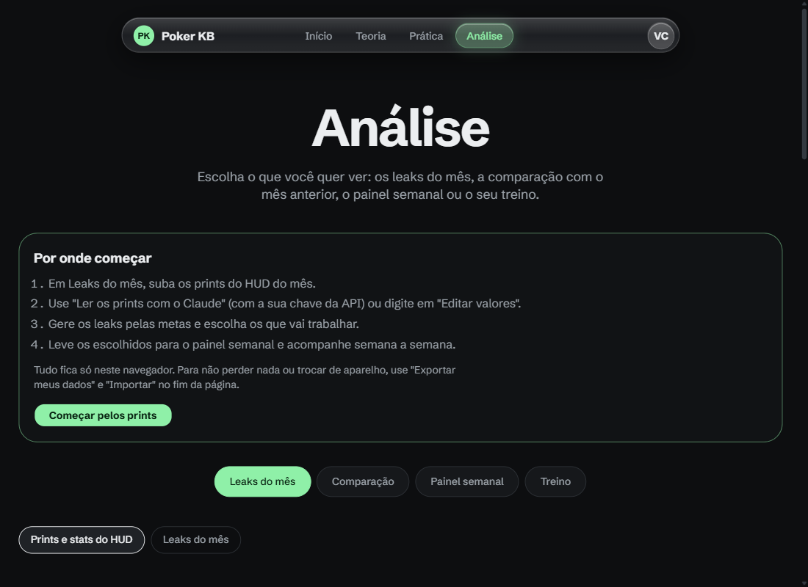
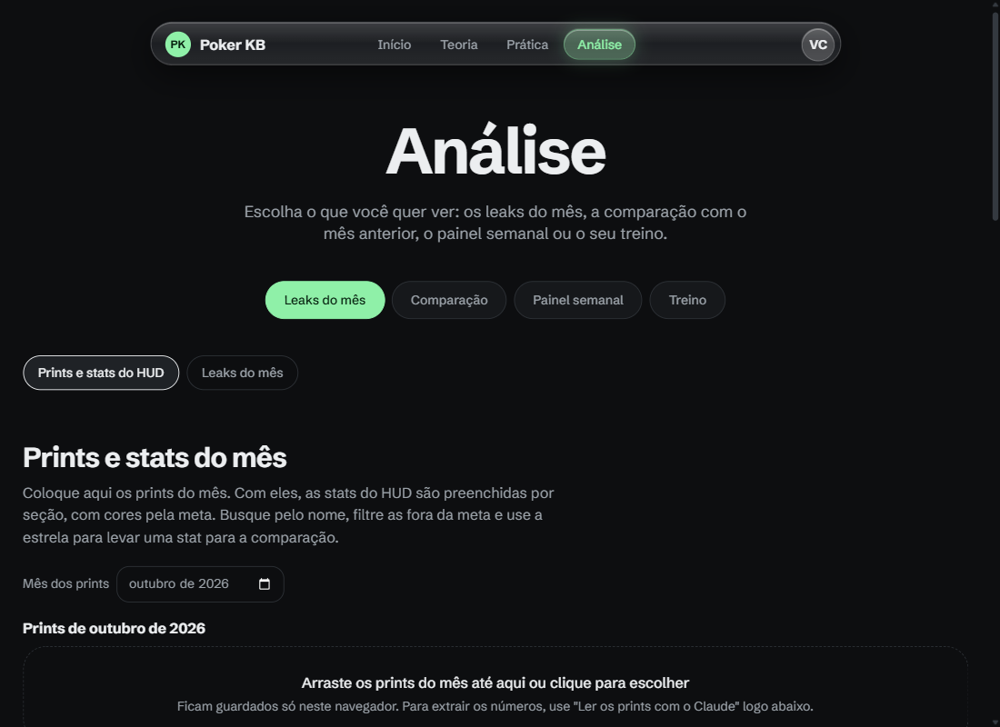
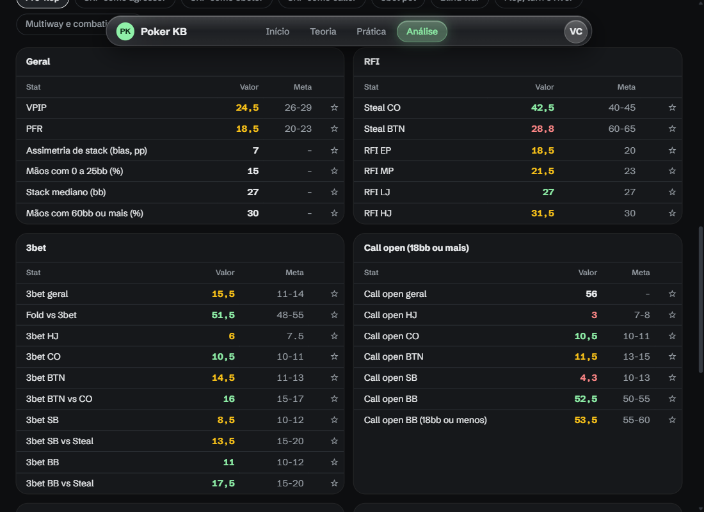
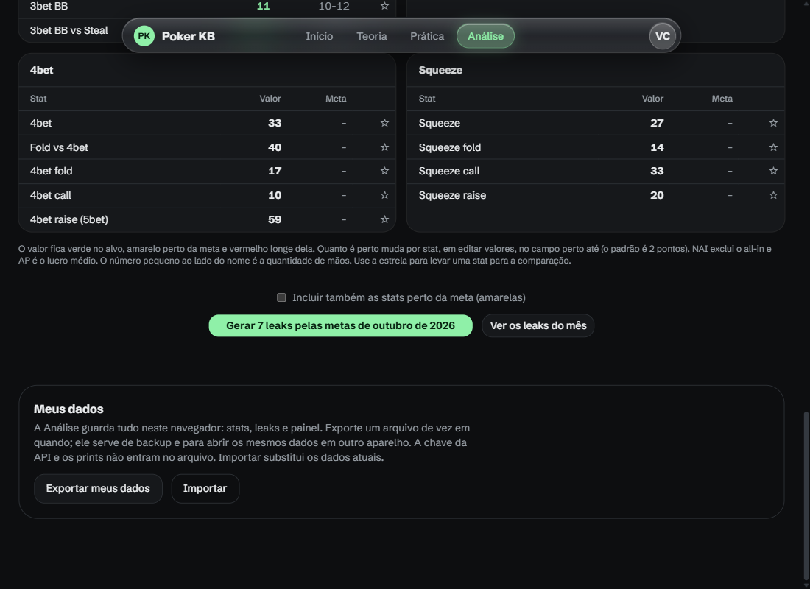
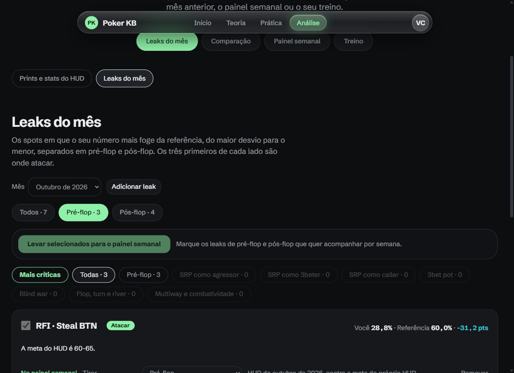
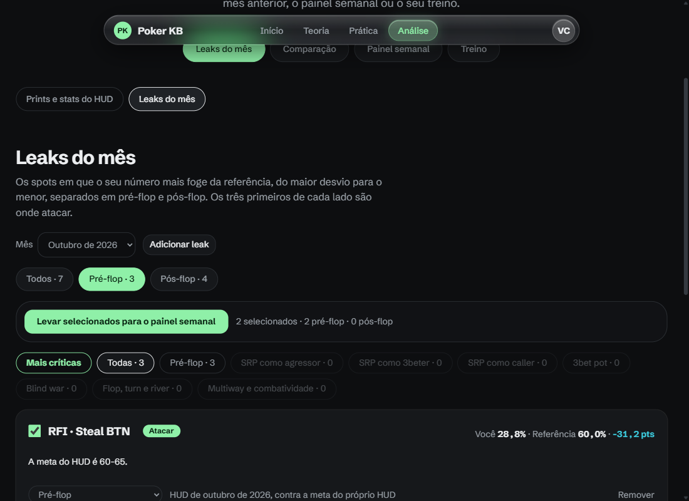
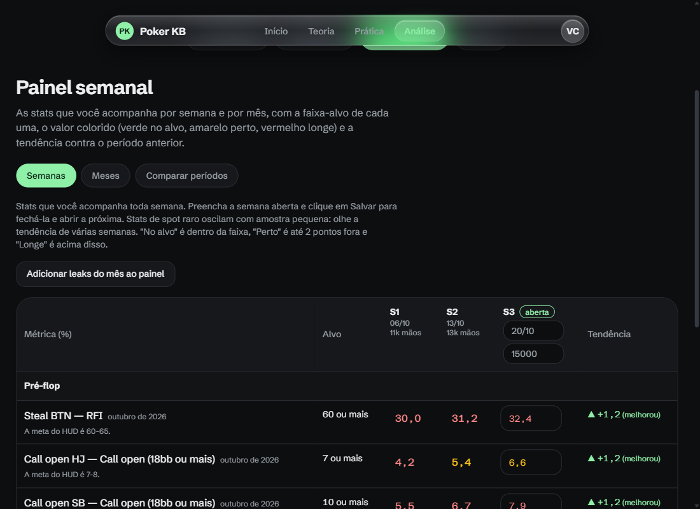
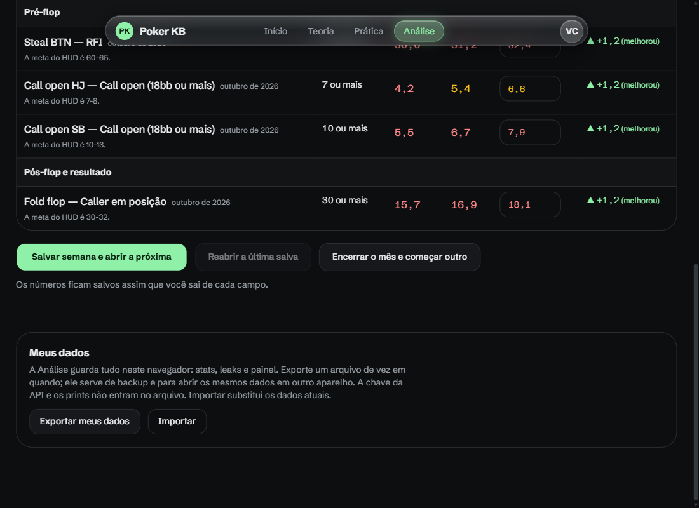

# Guia da Análise

A Análise é a sua área do site: aqui entram os números do seu HUD, o site mostra onde você foge das metas e você acompanha a evolução semana a semana. Tudo o que você digita fica só na sua conta; Teoria e Prática são iguais para todo mundo.

As imagens abaixo usam números inventados, só para ilustrar.

## O que você consegue fazer

- Guardar os prints do HUD de cada mês e deixar o Claude ler os números para você.
- Ver as 169 stats coloridas pela meta (verde no alvo, amarelo perto, vermelho longe).
- Gerar os leaks do mês automaticamente, filtrá-los por divisão da teoria e ver os mais críticos.
- Escolher os leaks que quer trabalhar e acompanhá-los semana a semana.
- Fechar o mês sem perder nada e começar o seguinte.
- Comparar meses e levar seus dados para outro aparelho.

## 1. Criar a conta e entrar

Abra o site e use **Criar conta** (e-mail e senha) ou **Continuar com o Google**. Na primeira vez a Análise abre vazia, com o cartão "Por onde começar".

## 2. Subir os prints e ler os números

Em **Leaks do mês → Prints e stats do HUD**, escolha o **Mês dos prints** e arraste os prints do HUD. Eles ficam só neste navegador.

Para o site ler os números, cole a sua chave da API da Anthropic em **Ler os prints com o Claude** e clique em **Ler os prints**. Ele mostra quantas stats leu antes de você aplicar. A leitura é cobrada na sua conta da Anthropic e a chave nunca sai do seu navegador. Se preferir, digite os valores em **Editar valores**.

## 3. Conferir as stats

As stats aparecem por seção, cada uma com o valor colorido pela meta. Dá para buscar pelo nome, filtrar só as fora da meta e fixar com a estrela as que quer acompanhar na Comparação. Qualquer número errado se corrige em **Editar valores**.

## 4. Gerar os leaks

No fim da página, **Gerar N leaks pelas metas** cria um leak para cada stat que está longe da meta. Marque também as stats "perto da meta" se quiser incluí-las. Stats sem meta e com amostra pequena ficam de fora.

## 5. Filtrar e escolher

Na aba **Leaks do mês** você vê os leaks por fase (Todos, Pré-flop, Pós-flop) e por divisão da teoria. **Mais críticas** mostra os 3 de maior desvio. A divisão de cada leak é um palpite e dá para trocar no próprio cartão.

## 6. Levar para o painel semanal

Marque os leaks que quer trabalhar, nas duas fases, e clique em **Levar selecionados para o painel semanal**. Eles viram as métricas que você acompanha até o fim do mês.

## 7. Acompanhar por semana

No **Painel semanal**, preencha a semana aberta (data, mãos e o valor de cada métrica) e clique em **Salvar semana e abrir a próxima**. O painel mostra a tendência contra a semana anterior.

Quando acabar o mês, **Encerrar o mês e começar outro** guarda as métricas e as semanas em **Ciclos anteriores** (nada é apagado) e abre um ciclo vazio para os leaks do mês seguinte. Os ciclos guardados também entram em **Comparar períodos**.

## 8. Comparação entre meses

Com dois meses de stats, a aba **Comparação** mostra o que mudou, da maior mudança para a menor, com as stats fixadas (estrela) primeiro.

## 9. Meus dados

No fim da página, **Exportar meus dados** baixa um arquivo com tudo (menos a chave da API e os prints) e **Importar** restaura. Serve de backup e para abrir os seus dados em outro aparelho.

## Dúvidas comuns

- **Alguém vê os meus números?** Não. Cada conta só lê os próprios dados.
- **Perdi o acesso ao Google/e-mail?** Use o arquivo exportado para recuperar os dados em uma conta nova.
- **O mês seguinte começa do zero?** Os leaks que continuarem aparecem de novo nas stats do novo mês, e você os leva de novo para o painel.
